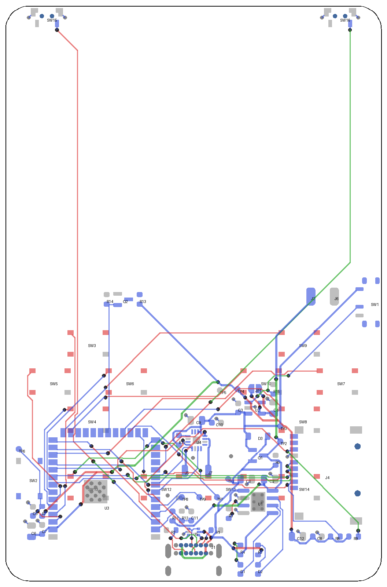

# PCB

Estado al 10 de noviembre de 2026: **4 capas, trazada toda menos la pantalla.** Falta el conector de la pantalla (J3), los agujeros de montaje y la serigrafía. Todavía no se puede fabricar.

Rojo: cara de enfrente. Azul: cara de atrás. Verde: capa interna 2. Vista desde enfrente.

## Qué tiene el archivo

- Contorno de 64 × 98 mm con esquinas de 4 mm de radio. Grosor de 0.8 mm, **4 capas**.
- Capas: enfrente (botones y señal), interna 1 (plano de tierra completo), interna 2 (señal y relleno de tierra), atrás (piezas y señal).
- Las 69 huellas del esquemático. Falta solo el conector de la pantalla (J3), que no tiene huella.
- **470 tramos de pista y 92 vías** (trazado rehecho el 13 de noviembre de 2026). Todas las redes conectadas menos las seis de la pantalla que van a J3 (CS, DC, MOSI, SCK, RST y los dos del LED), que se trazan cuando exista el conector.
- Zona sin cobre bajo la antena del ESP32, en las cuatro capas.
- Sin pistas ni vías en la cara de atrás bajo el cuerpo del USB-C y de la ranura microSD.
- Reglas: pista y separación mínimas de 0.15 mm, 0.3 mm a la orilla, vías de 0.6/0.3 mm, agujero mínimo de 0.2 mm. Clase `Potencia` de 0.4 mm para VBUS, VBAT, VSYS, 3.3 V y bocina; se adelgaza a 0.2 mm al entrar a los pads finos del amplificador y del USB-C.
- Dibujos de referencia en la capa `Dwgs.User`: pantalla, batería, anillo MagSafe y bocina. No se fabrican.

## Cómo se trazó

Con un trazador automático propio (`hardware/herramientas/router.py`), no a mano. La salida del USB-C sí está dibujada a mano dentro del script, porque los pads de D+ y D- van intercalados. Es un trazado válido, no bonito: conviene repasarlo en KiCad antes de fabricar.

Cambios de colocación que pidió el trazado: R1 y R2 intercambiaron lugar (cada una queda del lado de su pin CC) y C9 giró 180°.

## Adaptación a las piezas del profesor (13 de noviembre de 2026)

- **USB-C:** ahora es el GCT USB4085-GF-A, de pines atravesados. Va en la cara de atrás, sobresale 2.5 mm de la orilla y sus pines asoman por la cara de enfrente. Se suelda con cautín, no con pasta.
- **USBLC6-2P6 (U5):** nuevo, entre el conector y las resistencias de CC.
- **C1, C2, C4, C6, C9 y C12:** pasan de 0603 a 0805.
- **D2:** pasa de 0805 a 0603. D1 ahora es azul.
- **Q2** es 2N7002 y **D3** es 1N5819HW; mismas huellas.
- Se movieron un poco C4, C6, C10, C12, TP1, R1 y R2 para hacer lugar.
- La salida del USB ya no está dibujada a mano: con pines atravesados el trazador la resuelve solo.

Para repetirlo: `pipeline.sh` (traza, cose la tierra y limpia). Necesita KiCad 9 (`pcbnew`), `shapely` y `numpy`.

## Dónde quedó cada cosa

Las medidas son desde la esquina superior izquierda, viendo la consola de frente.

**Frente:** solo los botones.

| Elemento | Posición (x, y en mm) |
|---|---|
| Pantalla (referencia) | De 2 a 62 a lo ancho, de 2 a 45 a lo alto |
| Cruceta | Centro en (14, 64), botones a 6.5 mm del centro |
| X, A, B, Y | Centro en (50, 64). X arriba, A derecha, B abajo, Y izquierda |
| Menu, Select, Start y Option | En fila a y = 82: Menu en x = 14, Select en 26.5, Start en 37.5, Option en 50 |

**Atrás:** todo lo demás.

| Elemento | Posición |
|---|---|
| Gatillos L y R | Orilla superior, en x = 7 y x = 57. El botón asoma 0.4 mm |
| Batería (referencia) | Detrás de la pantalla, de 5.5 a 45.5 a lo alto |
| Anillo MagSafe (referencia) | Centro en (32, 31) |
| ESP32 | Abajo a la izquierda, antena al ras de la orilla inferior |
| USB-C | Orilla inferior, al centro. Sobresale 1.1 mm de la placa |
| Ranura microSD | Orilla derecha, centrada en y = 80 |
| Interruptor | Orilla derecha, en y = 50.5, arriba de donde va la mano |
| Cargador, reparto de carga y regulador | Columna entre el centro y la ranura microSD |
| Amplificador y pads de bocina | Centro, arriba del USB-C |
| Pads de batería | (52, 49.5) y (56, 49.5), justo debajo de la batería |
| Reset | A la izquierda del ESP32 |

## Qué marca la revisión de reglas

Revisada con `kicad-cli pcb drc` el 10 de noviembre de 2026:

- **Cero errores, cero conexiones sin trazar** entre las piezas que ya están en la placa.
- Falta la huella de J3.
- Avisos de serigrafía encimada o cortada por la orilla. Se arreglan al acomodar los textos.
- Las vías térmicas de 0.2 mm del ESP32 y del cargador ya no marcan aviso: en placas de 4 capas JLCPCB acepta agujeros de 0.2 mm, y como el anillo es de 0.6 mm no llevan cargo extra.

## Batería

Elegida: **LiPo 304050 con protección integrada** (3 × 40 × 50 mm, unos 600 mAh según el vendedor, 3.7 V, con cables). Cabe en el espacio de 55 × 40 × 3 mm dejando lugar para la plaquita de protección. Con un consumo estimado de 150 a 200 mA da de 3 a 4 horas.

R3 es de 3 kΩ: carga a unos 400 mA, más suave para la batería (decidido el 10 de noviembre de 2026; antes 2 kΩ y unos 600 mA).

## Decisiones que tomé y hay que confirmar

| Tema | Lo que puse | Por qué revisarlo |
|---|---|---|
| Antena del ESP32 | Orilla inferior, zona sin cobre solo bajo la antena | El USB-C queda pegado a la antena y el celular queda detrás. El WiFi puede salir débil. Se deja así y se mide en el prototipo |
| Centro del anillo MagSafe | A 31 mm de la orilla superior. Aprobado | Pensado para iPhone; falta la prueba física con un recorte de 64 × 98 mm |
| USB-C | Sobresale 2.5 mm; sus pines asoman por enfrente | Depende del grosor de la pared de la carcasa |
| Tornillos | No hay agujeros | Se definen con la carcasa. Al ponerlos habrá que mover las pistas que estorben |
| Pistas bajo la pantalla y la batería | Hay pistas en las dos caras de esa zona | Van cubiertas por la máscara; conviene poner cinta aislante bajo la batería |

## Ensamble

**La placa completa se arma a mano.** A JLCPCB solo se le pide la placa y el esténcil, y las piezas se compran aparte.

- Los botones se sueldan con cautín normal: sus cuatro patas salen por los lados.
- El amplificador y el ESP32 tienen pads por debajo. Necesitan pasta y pistola de calor o plancha.
- Las resistencias y condensadores son 0603 para que sean manejables a mano.

El ensamble en JLCPCB se descartó por costo. El ESP32-S3-WROOM-1-N16R8 solo se puede montar con el servicio estándar, y armar la cara de atrás de 5 placas salía en unos 115 USD contra unos 50 USD armándolas a mano (estimado del 10 de noviembre de 2026, sin envío ni impuestos).

## Lo que sigue

1. Cuando llegue el panel: elegir el conector de la pantalla, colocarlo y trazar sus seis pistas.
2. Agregar los agujeros de montaje según la carcasa.
3. Acomodar la serigrafía.
4. Repasar el trazado en KiCad y generar los archivos de fabricación.
